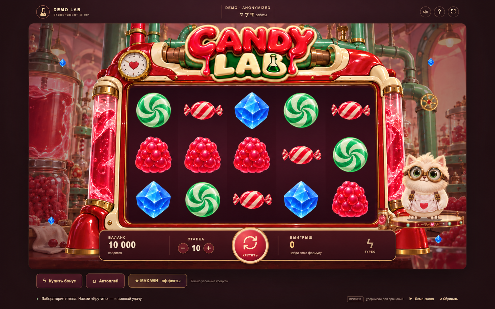

<a href="README.md">English</a> · <a href="README.ru.md">Русский</a>

<h1 align="center">Конфетная лаборатория</h1>

Яркая игровая демоверсия с барабанами, выразительным маскотом и живой визуальной обратной связью.

   

Публичная витрина закрытого проекта. Здесь представлены обезличенные интерфейсы и основные сценарии; исходный код и внутренние материалы остаются приватными.

## Основные сценарии

- Игровой цикл с барабанами
- Выразительная анимация маскота
- Отображение выигрыша и бонусные состояния

## Галерея

Каждый экран показан отдельно с сохранением пропорций. Названия, контакты и данные заменены демонстрационными. Это визуальная презентация, а не подтверждение доступности рабочей службы.

Часть изображений обезличена с помощью AI.

### Обзор интерфейса

---

[Все проекты](https://github.com/svllvsx)
